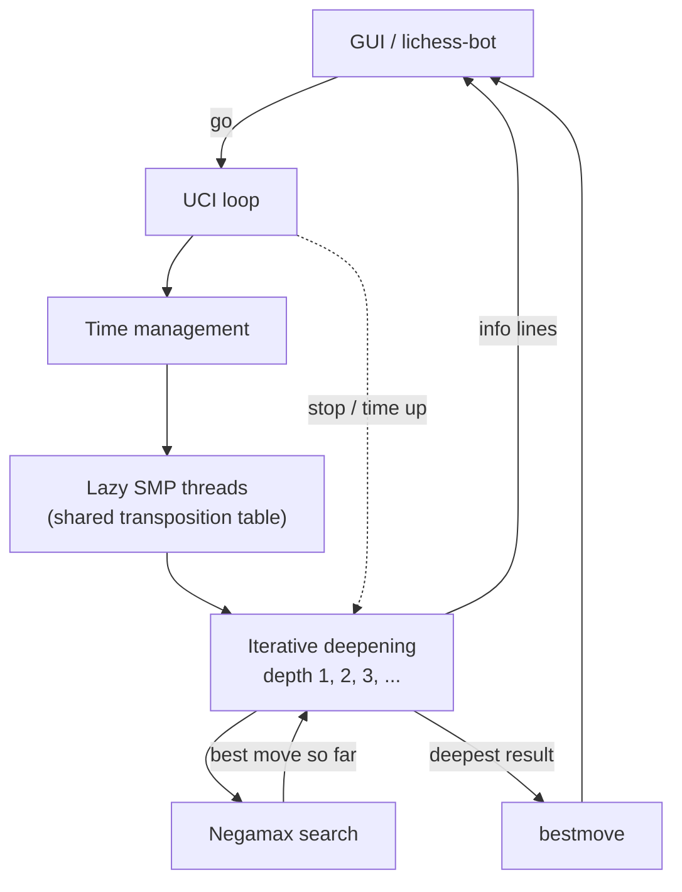
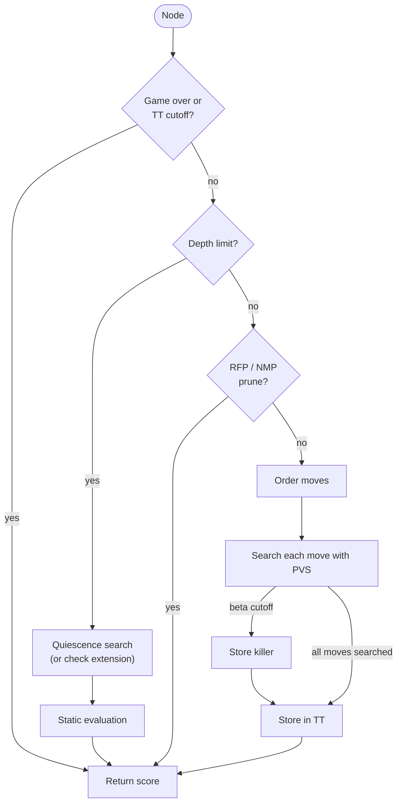

# Greenseer

A UCI-compatible chess engine written in Rust, named after the prophetic wargs of *A Song of Ice and Fire* — seers who look forward and backward through time, much like a search tree.

Built on top of [oxi_chess_lib](https://github.com/jnbradley828/oxi_chess_lib), which handles game state, move generation, move making/unmaking, and game result detection.

---

## Play Against Greenseer

Greenseer is live on Lichess — you can challenge it directly:

**[GreenseerEngine on Lichess](https://lichess.org/@/GreenseerEngine)**

The bot runs 24/7 on a self-managed [DigitalOcean](https://www.digitalocean.com/) VPS. Deployment is fully automated via a GitHub Actions CD pipeline that triggers on every push to `main`, waits for any in-progress game to finish, rebuilds the engine binary, and restarts the bot — no manual intervention required.

---

## How It Works

### Overview

**Each search node:**

### Search
Greenseer runs an **alpha-beta** search in **negamax** form: each node scores the position for the side to move, and a child's score is negated on the way back up.

### Iterative Deepening
The engine searches to depth 1, 2, 3, ... until it's stopped, runs out of time, reaches the depth limit, or proves a mate. Each iteration searches the previous best move first. The best move is updated after every root move, so an interrupted search still returns a valid answer.

### Move Ordering
Moves are ordered to produce early cutoffs: the transposition table move, then winning or even captures (ranked by SEE), then **killer moves** (quiet moves that recently caused a cutoff at the same ply), then other quiet moves, then losing captures.

### Static Exchange Evaluation (SEE)
SEE plays out the full capture/recapture sequence on a square to judge whether a capture wins material. It sorts captures for move ordering and filters out losing captures in quiescence search.

### Principal Variation Search (PVS)
The first move at each node is searched with the full window. Every later move gets a cheap **null-window** probe to check whether it can beat the current best; only moves that pass are re-searched with the full window.

### Search Pruning
- **Reverse futility pruning (RFP)** — at shallow depths, cut the node if the static eval already beats beta by a margin.
- **Null move pruning (NMP)** — if passing the turn still fails high in a reduced-depth search, cut the node. Disabled in check and in pawn-only positions, where zugzwang makes it unsafe.

### Quiescence Search
At the depth limit, the search keeps resolving non-losing captures until the position is quiet, so it never evaluates mid-exchange. The static eval serves as a "stand pat" floor, since the side to move can decline to capture. If the side to move is in check, the search extends one ply instead.

### Transposition Table
A **Zobrist-hashed** table caches each searched position's score, depth, bound type, and best move, so positions reached by different move orders aren't searched twice. Full keys are stored to avoid false matches, and entries are **aged** so results from earlier in the game get replaced first.

### Evaluation
Material plus **piece-square tables**, with separate middlegame and endgame weights blended by game phase. Additional terms:
- **King safety** — pressure on the king zone, pawn shield, open files near the king
- **Pawn structure** — passed, isolated, backward, and doubled pawns
- **Mobility** — squares attacked per piece
- **Bishop pair, rooks on open/semi-open files, tempo**
- **Trade incentive** — trade down when ahead, keep material when behind

All weights are in centipawns (pawn = 100) and live in `src/engine/eval_heuristics.toml`; search constants live in `search_heuristics.toml`. A build script compiles both into the binary as constants.

### Texel Tuning
Evaluation weights are tuned with **Texel's method** (`python/tuning/texel.py`): sample quiet positions from the [Lichess position evaluations dataset](https://huggingface.co/datasets/Lichess/chess-position-evaluations), then use coordinate descent to minimize the error between Greenseer's eval and Stockfish's, both mapped through a sigmoid.

### UCI
Supports `go depth`, `go movetime`, `wtime`/`btime`/`winc`/`binc`, and pondering (`go ponder` / `ponderhit`). Options: `Hash`, `Threads` (Lazy SMP), and `Ponder`.

### Benchmarking
Changes are tested with [fastchess](https://github.com/Disservin/fastchess), playing the `dev` build against `main` under **SPRT** until the result is statistically significant. `python/benches/fastchess_sprt.py` builds both engines, queues tournaments, and shows a live dashboard of SPRT stats alongside NPS and search depth for each build.

---

## Planned Improvements

- **SPSA tuning** — automated tuning of search parameters
- **NNUE** — replace the hand-crafted evaluation with an efficiently updatable neural network, trained on self-play data
- **More positional evaluation terms** — connected/protected passed pawns, knight outposts, connected rooks, piece batteries (e.g. queen/rook stacked on a file — "Alekhine's gun"), and space
- **More search pruning/reduction techniques** — late move reductions (LMR), late move pruning (LMP), futility pruning, aspiration windows, history heuristic, internal iterative reduction (IIR), and singular extensions
